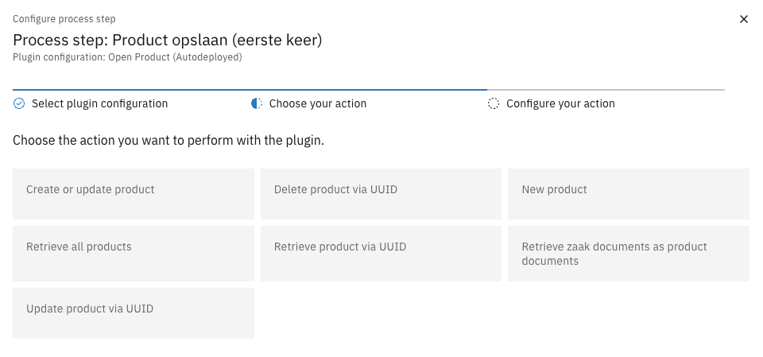
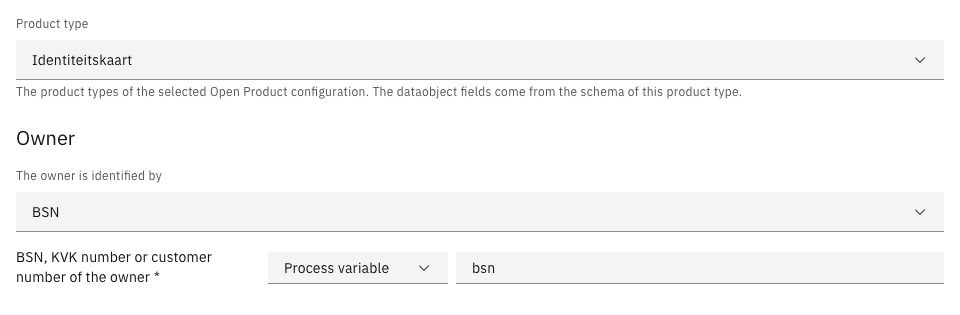
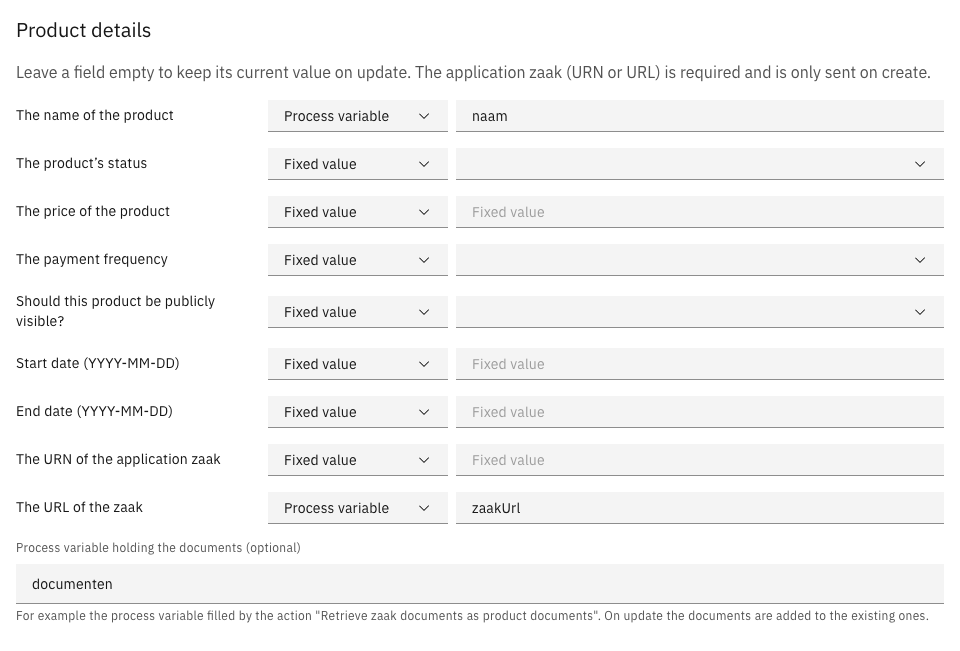
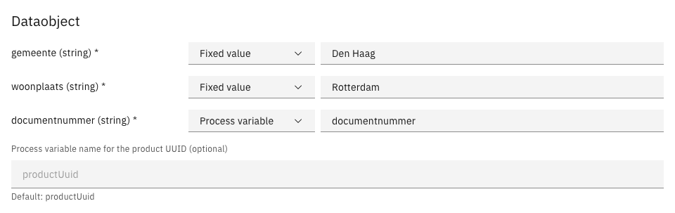

# Open Product Plugin

The Open Product plugin connects Valtimo to [Open Producten](https://github.com/maykinmedia/open-producten), the
register in which a municipality keeps the products its customers hold, such as permits and subsidies. Process
steps use the plugin to look up, create, update and delete products.

The plugin provides these plugin actions:

| Plugin action | Key | Purpose |
|---------------|-----|---------|
| Create or update product | `create-or-update-product` | Saves the owner's product of a product type: creates it the first time, updates it afterwards |
| New product | `create-product` | Creates a product |
| Update product via UUID | `update-product` | Updates the product with a known UUID |
| Retrieve product via UUID | `get-product` | Retrieves one product |
| Retrieve all products | `get-all-products` | Retrieves a list of products, optionally filtered |
| Retrieve zaak documents as product documents | `get-zaak-documenten` | Collects the documents of a zaak in the format a product's documents use |
| Delete product via UUID | `delete-product` | Deletes a product |

---

## Configuring the plugin

The plugin calls Open Producten with an API token. That token is kept in a separate **Token Authentication** plugin
configuration, so configure that one first.

1. Go to **Admin** > **Plugins** and click **Configure plugin**.
2. Select **Token Authentication** and enter the Open Producten API token.
3. Click **Configure plugin** again, select **Open Product Plugin** and fill in the properties below.

| Property | Description |
|----------|-------------|
| Configuration Name | The name used to identify this configuration in process links |
| URL | The root URL of the Open Producten instance, for example `https://openproducten.example.nl`. The plugin adds the API paths (`/producten/api/v1/` and `/producttypen/api/v1/`) itself |
| Authentication plugin configuration | The Token Authentication configuration that holds the Open Producten API token |

The configuration can also be autodeployed. An example `*.pluginconfig.json`:

```json
[
    {
        "id": "41f00cf2-17ec-40b8-a42f-bd9024a08892",
        "title": "Open Producten token",
        "pluginDefinitionKey": "tokenauthentication",
        "properties": {
            "token": "${OPEN_PRODUCT_TOKEN}"
        }
    },
    {
        "id": "4ac9a49f-4aeb-4f91-86d9-853fd95a1b33",
        "title": "Open Product",
        "pluginDefinitionKey": "openproduct",
        "properties": {
            "baseUrl": "${OPEN_PRODUCT_BASE_URL}",
            "authenticationPluginConfiguration": "41f00cf2-17ec-40b8-a42f-bd9024a08892"
        }
    }
]
```

Every value can be a `${ENVIRONMENT_VARIABLE}` placeholder. Use one for the token, so it is not stored in the
repository.

---

## Create or update product

> Available since Open Product plugin `1.4.0`.

The **Create or update product** action saves the outcome of a request as a product of one product type for one
owner. When the owner does not hold a current product of that type yet, the action creates one. When the owner already
holds one, the action updates that product. A process can therefore run the same step on a first request and on every
later change, without knowing the product's UUID.

Every field on the configuration screen offers a choice between a **Fixed value**, which is the same for every case,
and a **Process variable**, which is read from the running process. The screen also shows the fields of the product
type's own data (its dataobject schema), so these can be filled from the case without code.

### Configuring the action

1. Go to **Admin** > **Processes** and open the process.
2. Select the service task that saves the product and open its **Process link** section.
3. Select the Open Product plugin configuration and choose the action **Create or update product**.

   

4. Choose the **Product type** and how the owner is identified, and fill in the owner.

   

5. Fill in the product details the process provides. Leave the others empty.

   

6. Fill in the dataobject fields of the product type, and click **Complete**.

   

7. Save the process.

The product types in the list come from the Open Producten instance of the selected plugin configuration. The
configuration stores the product type's UUID, which differs per Open Producten instance: after moving a configuration to
another environment, choose the product type again.

| Property | Description |
|----------|-------------|
| Product type | The product type of the product. Required |
| The owner is identified by | **BSN**, **KVK number** or **Customer number** |
| BSN, KVK number or customer number of the owner | The owner's identifier. Required |
| Branch number | The owner's vestigingsnummer. Optional, and only shown when the owner is identified by KVK number |
| The name of the product | The product's name |
| The product's status | `initieel`, `in_aanvraag`, `gereed`, `actief`, `ingetrokken`, `geweigerd` or `verlopen`. A new product without a configured status is created with status `initieel` |
| The price of the product | The product's price |
| The payment frequency | `eenmalig`, `maandelijks` or `jaarlijks` |
| Should this product be publicly visible? | `true` or `false` |
| Start date, End date | The product's start and end date, as `YYYY-MM-DD` |
| The URN of the application zaak, The URL of the zaak | The zaak of the request the product came from. At least one of the two is required |
| Process variable holding the documents | A process variable holding a list of documents, for example the variable the action **Retrieve zaak documents as product documents** fills. Optional |
| Dataobject fields | One field per property of the product type's dataobject schema, with the property's type. Fields marked `*` are required by the schema and must be filled |
| Process variable name for the product UUID | The process variable in which the action stores the UUID of the saved product. Default: `productUuid` |

The configuration can only be completed with a product type, an owner, the application zaak (URN or URL) and every
required dataobject field.

An example process link, with fixed values and process variables:

```json
{
    "activityId": "save-product",
    "activityType": "bpmn:ServiceTask:start",
    "pluginConfigurationId": "4ac9a49f-4aeb-4f91-86d9-853fd95a1b33",
    "pluginActionDefinitionKey": "create-or-update-product",
    "actionProperties": {
        "producttypeUuid": "5d42a943-065a-46e7-8f17-54a5edbc88eb",
        "eigenaarType": "bsn",
        "eigenaarIdentificatie": "pv:bsn",
        "productNaam": "pv:naam",
        "aanvraagZaakUrl": "pv:zaakUrl",
        "documenten": "pv:documenten",
        "dataobjectMapping": [
            {"key": "gemeente", "value": "Den Haag"},
            {"key": "woonplaats", "value": "Rotterdam"},
            {"key": "documentnummer", "value": "pv:documentnummer"}
        ]
    },
    "processLinkType": "plugin"
}
```

A fixed value is stored as it is; a process variable is stored as `pv:<name>`. The other properties are
`eigenaarVestigingsnummer`, `productStatus`, `productPrijs`, `productFrequentie`, `gepubliceerd`, `startDatum`,
`eindDatum`, `aanvraagZaakUrn` and `resultaatVariabelNaam`. Besides `pv:`, any other value reference Valtimo knows,
such as `doc:`, can be used.

### What the action does

When the process reaches the step, the action looks up the owner's products of the configured product type in Open
Producten. It matches on every identifier configured for the owner, and ignores products with status `ingetrokken`,
`geweigerd` or `verlopen`.

| The owner has | The action |
|---------------|------------|
| No current product of the type | Creates a product with the product type, the owner, the configured product details, the application zaak, the documents and the dataobject fields |
| One current product of the type | Updates that product |
| More than one current product of the type | Stops with an error that lists the products. Use **Update product via UUID** to update a specific one |

On an update:

- Only the fields that are filled in are sent. A field left empty, the status included, keeps its current value.
- The owners, the product type and the application zaak are not changed. They describe the request the product came
  from and are only sent when the product is created.
- The dataobject fields are added to the product's current data. Properties the action does not fill keep their value.
- The documents are added to the product's current documents. Documents the product already has are not added twice.

In both cases the action stores the product's UUID in the configured process variable (`productUuid` by default).

Dataobject fields are sent with the type the product type's schema gives them: a fixed `12` for a `number` property is
sent as the number 12, a fixed `2026` for a `string` property as the text "2026". A value that cannot be converted is
sent as it is, and Open Producten rejects it. A field whose process variable is not set is left out. A property of
type `object` or `array` is filled as a whole, normally from a process variable that holds that structure.

### Things to keep in mind

- A fixed value in the owner and product details fields must not start with a word followed by a colon, such as
  `urn:nld:...` or `Request: 2026`. Valtimo reads such a value as a value reference (like `pv:` or `doc:`) and the step
  fails. Put such a value, typically the application zaak URN, in a process variable and map that variable instead.
  `http:` and `https:` URLs do work as fixed values, but Valtimo drops anything from a `?` in them.
  Dataobject fields do not have these limitations.
- The owner's identifier must have a value when the step runs. When it is empty, the action stops before calling Open
  Producten.

---

## The other actions

The other actions take their values as text. A value can be fixed, or a reference such as `pv:<name>` for a process
variable or `doc:<path>` for a field of the case document.

### New product

Creates a product and stores its UUID in the process variable `aangemaaktProductUuid`.

| Property | Description |
|----------|-------------|
| The name of the product | The product's name |
| The UUID of the product type | The UUID of the product type in Open Producten |
| The citizen service number (BSN) of the owner | The owner's BSN |
| The URN of the application zaak, The URL of the zaak | The zaak of the request the product came from |
| The price of the product | The product's price |
| The payment frequency | `eenmalig`, `maandelijks` or `jaarlijks` |
| The product's status | `initieel`, `gereed`, `actief`, `ingetrokken`, `geweigerd` or `verlopen` |
| Should this product be publicly visible? | `true` or `false` |
| Process variable name for the data object | A process variable holding the product's dataobject as a map. Optional |

### Update product via UUID

Updates the product with the given UUID. It has the same properties as **New product**, plus **The UUID of the
product**. Both actions also accept `koppelZaakDocumenten` (attach the zaak's documents), and this one
`documentenVariabelNaam` (a process variable holding the documents); these are set in a process link file only.

### Retrieve product via UUID

Retrieves the product with the given UUID. When **Process variable name for the data object** is filled in, the
product's dataobject is stored in that process variable.

### Retrieve all products

Retrieves the products that match the optional filters **product type UUID**, **owner BSN** and **status**, and stores
them in a process variable (`alleProducten` by default). A readable summary is stored in the same name followed by
`Tekst`, for example `alleProductenTekst`.

### Retrieve zaak documents as product documents

Retrieves the documents linked to the zaak with the given URL and stores them as a list of `{"url": ...}` entries in a
process variable (`zaakDocumenten` by default). This is the format the **Process variable holding the documents**
field of **Create or update product** expects. The zaak is read through the Zaken API plugin configuration for that
zaak's URL.

### Delete product via UUID

Deletes the product with the given UUID.

---

## When a call to Open Producten fails

When Open Producten rejects a call, for example because a required field is missing or a value is invalid, or cannot
be reached, the process stops at that step with an incident. The message names the operation and contains Open
Producten's own explanation, for example:

```text
Open Producten: product aanmaken mislukt met status 400: {"code":"invalid","title":"Ongeldige invoerwaarde.", ...,
"invalid_params":[{"name":"eigenaren.0.bsn","code":"invalid","reason":"Ongeldig bsn number."}]}
```

Valtimo shows its own generic message on the incident (`Failed to invoke event listener method`); the message above is
in the incident's cause, in its stack trace. The backend log also records the method, URL, status and response body of
every failed call.

For developers: the exception keeps its Spring type — `HttpClientErrorException` or `HttpServerErrorException` with
the status-specific subtype (both `RestClientResponseException`) for an error status, and `ResourceAccessException`
when Open Producten cannot be reached — so existing `catch` clauses keep working. Only the message is new.

---

## Management endpoints

The configuration screen of **Create or update product** reads the product types through these endpoints. They are
only available to users with the `ROLE_ADMIN` role.

| Method | Path | Returns |
|--------|------|---------|
| GET | `/api/management/v1/openproduct/{pluginConfigurationId}/producttypen` | The product types (`uuid`, `naam`, `code`) of the Open Producten instance of that plugin configuration, across all result pages |
| GET | `/api/management/v1/openproduct/{pluginConfigurationId}/producttypen/{producttypeUuid}/dataobject-schema` | The dataobject JSON schema of that product type, as `{"schema": {...}}` |

---

## Dependencies

### Backend

```kotlin
dependencies {
    implementation("com.ritense.valtimoplugins:open-product:1.4.0")
    implementation("com.ritense.valtimoplugins:token-authentication:0.9")
}
```

### Frontend

```json
{
  "dependencies": {
    "@valtimo-plugins/open-product": "1.4.0"
  }
}
```

In `app.module.ts`:

```typescript
import {OpenProductPluginModule, openProductPluginSpecification} from '@valtimo-plugins/open-product';

@NgModule({
    imports: [
        OpenProductPluginModule,
    ],
    providers: [
        {
            provide: PLUGIN_TOKEN,
            useValue: [
                openProductPluginSpecification,
            ]
        }
    ]
})
```
